# Speech-to-Text

A self-hosted web app that transcribes audio files and tells the speakers apart. Drop in as many recordings as you like: they wait in a queue and are transcribed one after another on your own machine, with [whisper.cpp](https://github.com/ggml-org/whisper.cpp) for the speech and a CAM++ speaker model for "who spoke when". Nothing leaves your computer.

- **Upload many files at once** — audio and common video containers (`mp3`, `wav`, `flac`, `ogg`, `opus`, `m4a`, `aac`, `wma`, `aiff`, `amr`, `webm`, `mp4`, `mov`, `mkv`, `3gp` and more; the full list is [`docs/api/allowed-extensions.json`](docs/api/allowed-extensions.json)). The same file uploaded twice is recognized and not processed again.
- **A queue you control** — pause and resume the whole queue or a single task, cancel, retry, delete, and reorder by drag and drop. Progress updates live while a task runs.
- **Transcription with speaker diarization** — pick the language or let it auto-detect; let the app find the number of speakers, fix it, or switch speakers off.
- **History** — every finished transcription stays available, also after a restart.
- **Playback** — listen to the recording with the transcript highlighted as it plays; the view follows along, and clicking a sentence jumps there.
- **Speakers** — rename a speaker ("Speaker 1" → "Alice") or merge two speakers into one; a merge can be undone.
- **Downloads** — the transcript as plain text (`.txt`) or subtitles (`.srt`, `.vtt`), labelled with the speaker names.
- **Settings** — choose the compute device (automatic, CPU or a GPU) and the defaults for new uploads.

| Upload and queue | Playback that follows the transcript | Rename and merge speakers |
| --- | --- | --- |
| 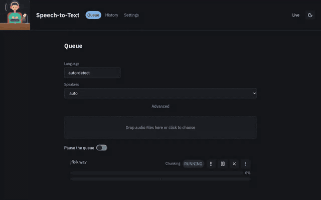 | 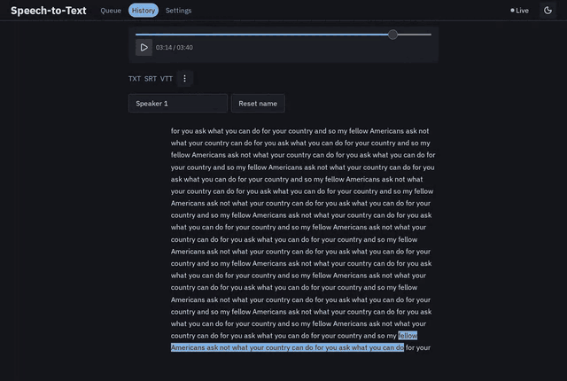 | 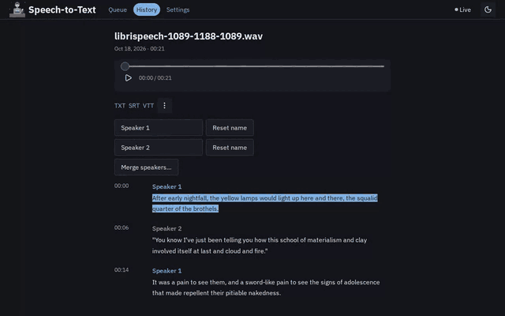 |

<details>
<summary>Screenshots (light and dark)</summary>

| | Light | Dark |
| --- | --- | --- |
| Queue with a running task | 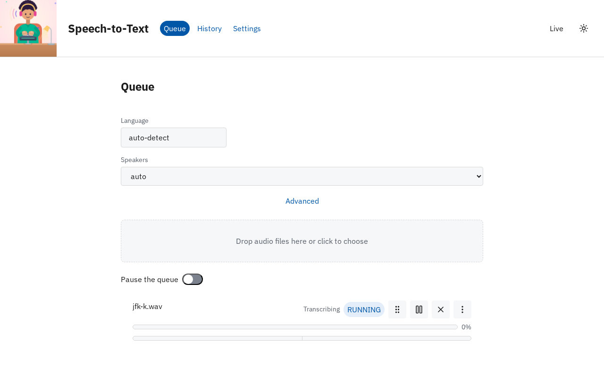 | 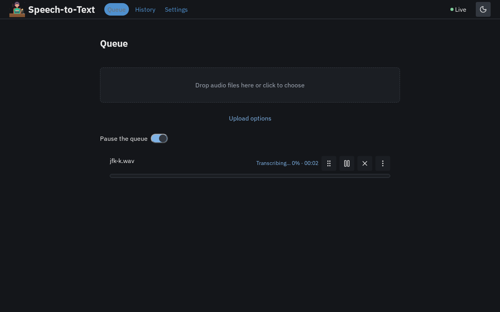 |
| An upload in flight | 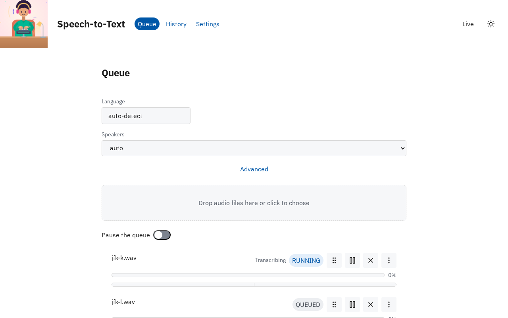 | 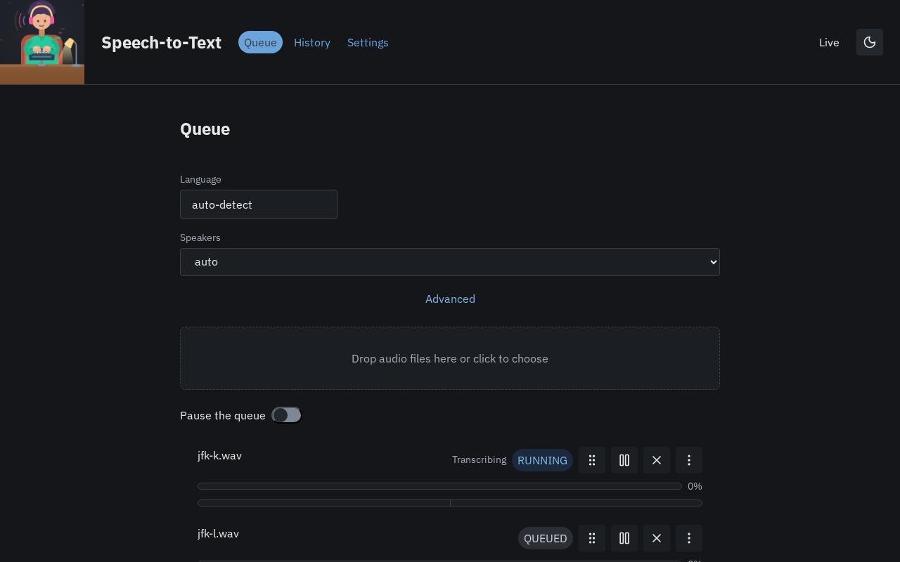 |
| History | 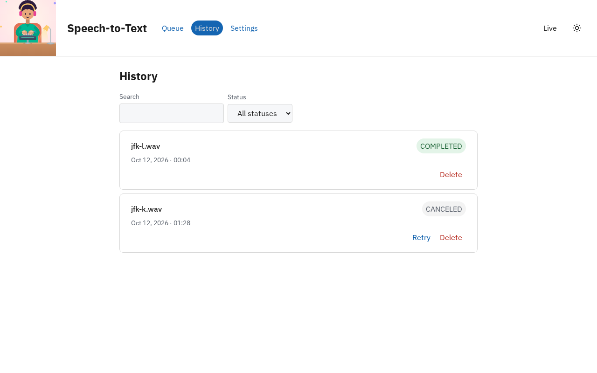 | 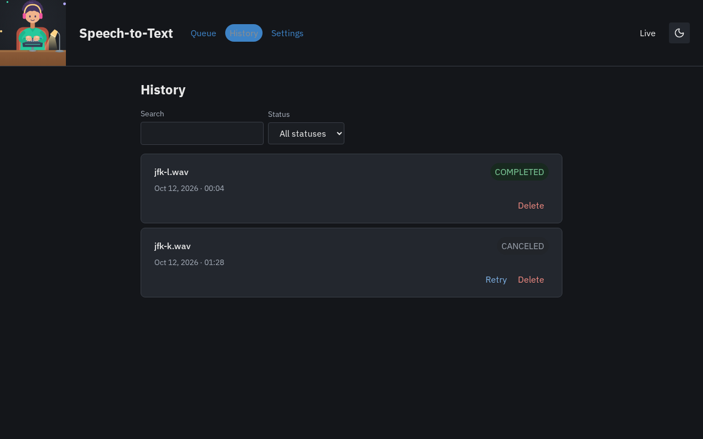 |
| Transcript during playback | 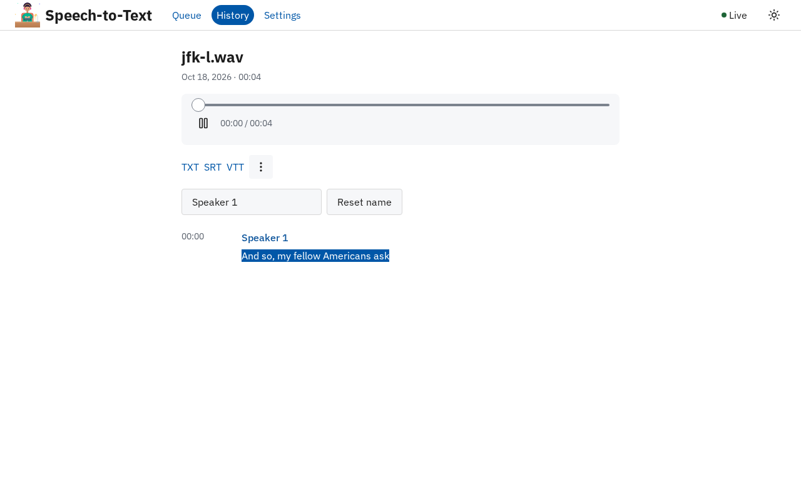 | 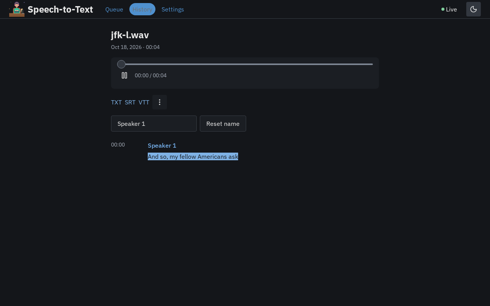 |
| A canceled task | 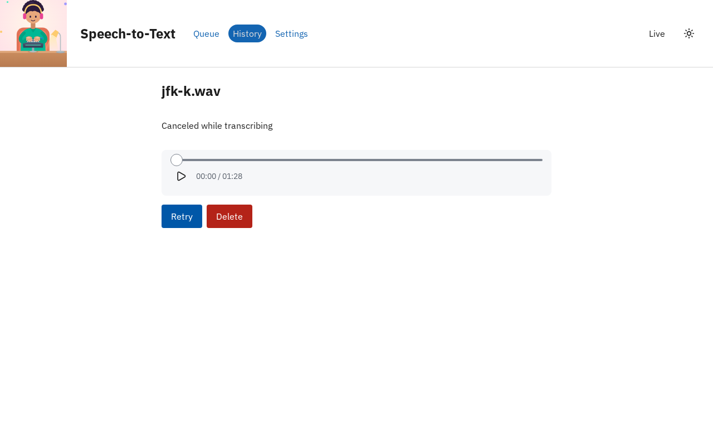 | 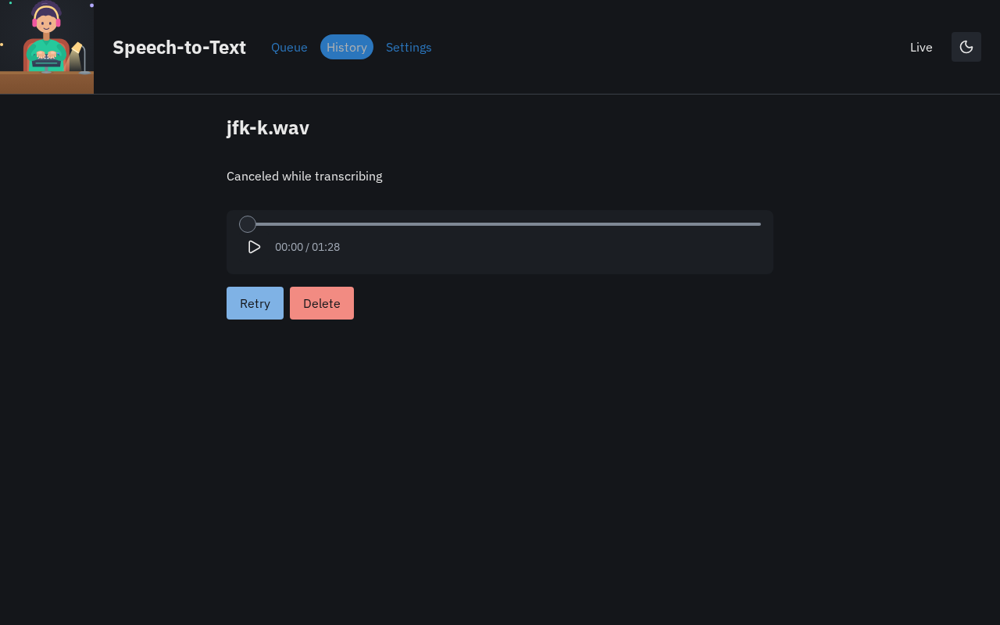 |

</details>

How it works inside — the components, the life of a task, the data model, the API and the frontend — is the [architecture overview](docs/architecture.md).

## Ways to run it

| | Who it is for | Status |
| --- | --- | --- |
| [Packaged app with Nix](#packaged-app-with-nix) | Using the app | available |
| [Development environment (devenv)](#development-environment-devenv) | Working on the app | available |
| [Docker](#docker) | Using the app without Nix | available |
| [Gradle without Nix](#gradle-without-nix) | Working on the app without Nix | available |

All ways need **Linux on x86-64**; the Gradle path also has macOS builds, untested. A GPU is optional: whisper.cpp runs on any GPU with a **Vulkan** driver and falls back to the CPU otherwise. The first build of the package, the development shell or the Docker image downloads about 600 MB of models.

### Packaged app with Nix

Prerequisites: [Nix](https://nixos.org/download/) with flakes enabled (`experimental-features = nix-command flakes` in `nix.conf`). Everything else — Java, whisper.cpp, ffmpeg, the models and the built frontend — comes with the package.

```sh
git clone https://github.com/lulu-berlin/speech-to-text-app.git
cd speech-to-text-app
nix run .
```

Then open <http://localhost:8080>. `nix build .` builds the same app into `./result/bin/stt-app` without starting it. Details: [docs/specs/nix-flake-package.md](docs/specs/nix-flake-package.md).

### Development environment (devenv)

Prerequisites: [Nix](https://nixos.org/download/), [devenv](https://devenv.sh/getting-started/) and, recommended, [direnv](https://direnv.net/) (hooked into your shell). The development shell provides every tool and pins every version — JDK 21, Gradle, Node.js, pnpm, whisper.cpp, ffmpeg, SQLite, Playwright and the models ([ADR 0010](docs/decisions/0010-development-toolchain.md)); nothing else is installed by hand.

```sh
git clone https://github.com/lulu-berlin/speech-to-text-app.git
cd speech-to-text-app
direnv allow        # or: devenv shell
```

**Dev mode** — the whole app with one command, the frontend with hot reload and the backend rebuilt and restarted when its sources change ([docs/specs/dev-mode.md](docs/specs/dev-mode.md)):

```sh
devenv up
```

Open the Vite URL it prints (<http://localhost:5173>). Stop with Ctrl-C, then `q`, or run `devenv down`.

**The app as it ships, from source** — build the frontend once and let the backend serve it:

```sh
(cd frontend && pnpm install && pnpm build)
cd backend
STT_STATIC_DIR=../frontend/dist gradle run
```

Then open <http://localhost:8080>. Tests and the other commands are in [AGENTS.md § Commands](AGENTS.md#commands).

### Docker

Prerequisites: Docker with Compose v2. Nothing else: the image is built on your machine from this repository's Nix flake, inside a `nixos/nix` build container, so the host needs no Nix; nothing is pulled from or pushed to an app registry. On macOS and Windows, Docker Desktop runs the Linux image on the CPU only.

```sh
git clone https://github.com/lulu-berlin/speech-to-text-app.git
cd speech-to-text-app
docker compose up -d --build
```

Then open <http://localhost:8080>. The first build takes a while (about 11 minutes on the machine it was tested on: it downloads the pinned nixpkgs and the models and runs the backend's tests); later builds reuse Docker's cache until the flake or the sources change. The image is about 3.3 GB.

- `docker compose ps` — the status; a healthcheck calls `GET /api/health`.
- `docker compose logs -f stt-app` — the app's log.
- `docker compose stop` / `docker compose start` — a task interrupted by `stop` continues after `start`.
- `docker compose down` — removes the container; the data stays in the `stt-data` volume ([Where your data lives](#where-your-data-lives)). `docker compose down -v` deletes it.

The container runs as an unprivileged user (uid 1000) and writes only to its data volume and scratch space.

**GPU.** `docker-compose.yml` alone runs on the CPU. An override file adds a GPU; the Settings page then lists the GPUs the container sees, and the default device (automatic) uses the first one.

| GPU | The host needs | Start with |
| --- | --- | --- |
| NVIDIA | the [NVIDIA Container Toolkit](https://docs.nvidia.com/datacenter/cloud-native/container-toolkit/latest/cdi-support.html) with a CDI spec — on NixOS `hardware.nvidia-container-toolkit.enable = true;`, elsewhere `nvidia-ctk cdi generate --output=/etc/cdi/nvidia.yaml` | `docker compose -f docker-compose.yml -f docker-compose.gpu-nvidia.yml up -d` |
| Intel / AMD | only the kernel's GPU driver: the image brings Mesa's Vulkan drivers | `STT_RENDER_GID=$(getent group render \| cut -d: -f3) docker compose -f docker-compose.yml -f docker-compose.gpu-vulkan.yml up -d` |

`STT_RENDER_GID` lets the container's user open the render device. Both variants were tested on NixOS (an AMD Radeon iGPU and an NVIDIA RTX 3050); NVIDIA on other distributions is untested. Details: [roadmap item 19](docs/specs/docker-image-and-compose.md).

### Gradle without Nix

For working on the app without Nix: the repository's `./gradlew` downloads everything else itself — Gradle 9.8, JDK 21, Node.js, pnpm, whisper-cli 1.8.4, ffmpeg 8.1 and the models — at the versions the Nix flake pins (the committed [`versions.json`](versions.json), which the flake checks), and verifies every file's SHA-256. Linux x86-64 is tested; the macOS builds (Intel and Apple Silicon) are best-effort and untested. This path is for people; AI agents working on the repository keep to Nix and devenv ([AGENTS.md](AGENTS.md)).

Prerequisites:

- **Java 21 or newer** (Gradle 9.8 itself runs on Java 17–27, but the backend compiles with `-Xjdk-release=21`, so a 17–20 launcher JVM cannot build it). The app is run with JDK 21, which Gradle downloads when your Java is another version.
- **Linux**: glibc 2.38 or newer (Ubuntu 24.04+, Debian 13+, Fedora 39+) and the system libraries the prebuilt tools are linked against — only this path needs them; Nix, devenv and Docker bring their own:
  - whisper-cli: `libstdc++6`, `libgomp1` and the Vulkan loader `libvulkan1` (needed even without a GPU);
  - ffmpeg: `libasound2` (`libasound2t64` on Ubuntu 24.04+ and Debian 13), `libpulse0`, `libxcb1`, `libxcb-shm0` and `libudev1`.

  On Ubuntu 24.04, with Java and git:

  ```sh
  sudo apt-get install -y openjdk-25-jdk-headless git \
    libgomp1 libvulkan1 libasound2t64 libpulse0 libxcb1 libxcb-shm0 libudev1 libstdc++6
  ```

- **macOS**: `setsid` (the app starts whisper-cli and ffmpeg through it), from Homebrew's `util-linux`, which does not put it on `PATH` by itself:

  ```sh
  brew install util-linux
  export PATH="$(brew --prefix util-linux)/bin:$PATH"
  ```

```sh
git clone https://github.com/lulu-berlin/speech-to-text-app.git
cd speech-to-text-app
./gradlew run
```

Then open <http://localhost:8080>; stop with Ctrl-C. The first run downloads about 850 MB (more when Gradle also has to download JDK 21) and builds the frontend and the backend. Later runs reuse the downloads and still check every file's SHA-256.

- `./gradlew dev` — dev mode, like `devenv up`: the Vite dev server on <http://localhost:5173> with hot reload, and the backend rebuilt and restarted when its sources change. Vite is ready first; the API answers once the backend has built and logs `Responding at`. Ctrl-C stops both.
- `./gradlew e2e` — the [end-to-end tests](e2e/) against the built app, with Gradle's own test fixtures and Chromium. On Linux, Chromium also needs system libraries from apt (Debian and Ubuntu only). `./gradlew e2eSystemDeps` installs them when run as root, for example in a container; run as yourself, it only checks them and, if some are missing, fails with the `sudo apt-get install …` line to run (Gradle never asks for your password):

  ```sh
  ./gradlew e2eSystemDeps
  ./gradlew e2e
  ```

- `./gradlew checkVersions` — checks that `versions.json` still matches the Gradle wrapper and the flake's locked nixpkgs.
- `./gradlew -p backend check` — the backend's tests. They need a UTF-8 locale, for example `export LANG=C.UTF-8` first; `./gradlew run` does not. A running Gradle daemon keeps the locale it started with, so after changing it run `./gradlew --stop` once.

Where things live:

- The downloads: `~/.gradle/stt-app/` (`dl/`, `tools/`, `models/`, `fixtures/`, `node/`, `ms-playwright/`), shared by every clone; `GRADLE_USER_HOME` moves it with the rest of Gradle's files. Deleting it is safe: the next run downloads again.
- The data: `${XDG_DATA_HOME:-~/.local/share}/stt-app`, the same directory as the Nix package's ([Where your data lives](#where-your-data-lives)).
- Every [`STT_*` variable](#configuration) you set yourself wins over Gradle's default, for example `STT_DATA_DIR` or `STT_PORT`.

## Configuration

The backend is configured with environment variables. The Nix package, the development shell and `./gradlew run`/`dev` set all of them; you only set them yourself to change something.

| Variable | Required | Meaning |
| --- | --- | --- |
| `STT_DATA_DIR` | yes (the Nix package and `./gradlew` have a default) | Where the database and the stored audio live — see [Where your data lives](#where-your-data-lives). |
| `STT_WHISPER_MODEL` | yes | The whisper.cpp model file. The pinned default is `large-v3-turbo-q5_0` ([ADR 0008](docs/decisions/0008-default-whisper-model.md)). |
| `STT_SPEAKER_MODEL` | yes | The CAM++ speaker-embedding model (ONNX) used for diarization ([ADR 0003](docs/decisions/0003-kotlin-diarization-campplus-onnx.md)). |
| `STT_PORT` | no | The HTTP port, default `8080`. |
| `STT_STATIC_DIR` | no | A built frontend (`frontend/dist`) to serve. Unset, the backend serves only the API. |

A missing required variable or an invalid port stops the app at startup with a message naming it. `whisper-cli` and `ffmpeg` are run from `PATH` ([ADR 0047](docs/decisions/0047-external-tools-resolved-from-path.md)).

The compute device (automatic, CPU or a specific GPU), the number of threads and the defaults for new uploads (language, speakers) are not environment variables: they are set on the app's **Settings** page and stored in the database ([docs/specs/settings-page.md](docs/specs/settings-page.md)).

## Where your data lives

Everything the app keeps — the queue, the transcripts, the speaker names and the audio — is in one directory:

| How you run it | Data directory |
| --- | --- |
| Nix package | `$STT_DATA_DIR` if set, else `${XDG_DATA_HOME:-~/.local/share}/stt-app` |
| `devenv up` and the devenv shell | `.devenv/state/stt` inside the repository (git-ignored, survives restarts) |
| `gradle run` | `$STT_DATA_DIR`, which you choose |
| `./gradlew run` and `./gradlew dev` | `$STT_DATA_DIR` if set, else `${XDG_DATA_HOME:-~/.local/share}/stt-app` |
| Docker | the named volume `stt-data`, mounted at `/data` in the container |

Inside it:

- `stt.db` — the SQLite database, with `stt.db-wal` and `stt.db-shm` next to it (write-ahead log). It holds the tasks, the transcripts, the speakers, the settings and the audio of every task that has been split into chunks.
- `work/` — per-task scratch space; the uploaded original stays here until the task has been split into chunks.
- `tmp/` — upload spools and the playback cache; cleared on every start.

**Backup**: stop the app, then copy the whole directory (`tmp/` may be left out). Restore by copying it back while the app is stopped. Copying only `stt.db` is not enough: the write-ahead log and the originals in `work/` are part of the state ([ADR 0017](docs/decisions/0017-database-location-and-connection-contract.md), [ADR 0024](docs/decisions/0024-audio-storage-original-until-chunking-flac-chunks.md)). If the app stops while a task runs, that task continues from its last finished chunk on the next start.

With Docker, back up the volume while the app is stopped, and restore it the same way (the restored files belong to the container's user, uid 1000):

```sh
docker compose stop
docker run --rm -v stt-data:/data:ro -v "$PWD":/backup alpine:3 tar czf /backup/stt-data.tar.gz -C /data .
# restore: docker run --rm --user 1000:1000 -v stt-data:/data -v "$PWD":/backup alpine:3 tar xzf /backup/stt-data.tar.gz -C /data
docker compose start
```

## Documentation

- [Architecture overview](docs/architecture.md) — a guided tour of how the app works and where each part lives in the code.
- [Specifications](docs/specs/) — one per finished roadmap item, with its test list.
- [Decisions](docs/decisions/README.md) — the architecture decision records.
- [API examples](docs/api/README.md) — an example of every response and live event of the HTTP API.
- [Roadmap](roadmap/README.md) — pending work.
- [AGENTS.md](AGENTS.md) — how this repository is developed: the rules, the workflow and the commands.

## Licenses and attributions

The app is licensed under the [BSD 3-Clause License](LICENSE). Third-party material:

- **Test fixtures** — clips from the LibriSpeech ASR corpus (CC BY 4.0); see [docs/attributions.md](docs/attributions.md).
- **Models** — the whisper.cpp model ([ADR 0008](docs/decisions/0008-default-whisper-model.md)) and the CAM++ speaker model ([ADR 0003](docs/decisions/0003-kotlin-diarization-campplus-onnx.md)) are downloaded from their publishers at build time, not stored in the repository; their sources are pinned in [`nix/models.nix`](nix/models.nix).
