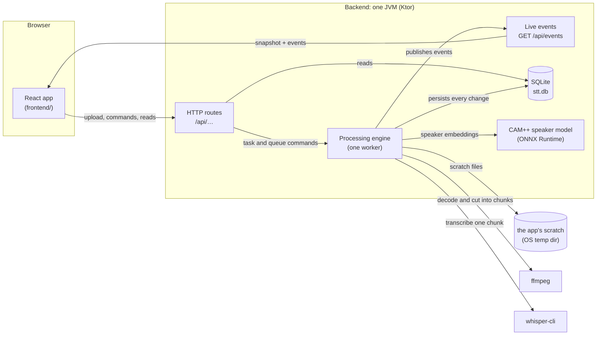

# Architecture overview

A guided tour of how the speech-to-text app works, for people who use it and people who work on it. Each section explains one part in plain words and ends with **Where in the code**, the files to open next. Decisions are not repeated here: each section links the specification ([docs/specs/](specs/)) and the decision records ([docs/decisions/](decisions/README.md)) that hold them.

Read it in order the first time: the big picture, then one task's journey from upload to transcript, then what is stored, how the browser talks to the backend, and how the frontend is built.

## 1. The big picture

The app is one program: a Kotlin backend that serves a React frontend, keeps everything in one SQLite database, and drives two external programs and one in-process model to do the work.

- **The browser** shows the queue, the history, a transcript with its player, and the settings. It changes things only through HTTP requests and learns about every change from one live event stream.
- **The HTTP routes** accept uploads and commands, answer reads from the database, and serve the built frontend.
- **The processing engine** is a single worker that takes the next queued task and runs it to the end: cut the audio into chunks with ffmpeg, transcribe each chunk with whisper-cli, then find the speakers with the CAM++ model. It writes every change to the database first and then announces it as an event.
- **The database** is one SQLite file in the data directory; it also holds every task's canonical clip — the whole recording in one format — so playback needs no file. The data directory holds that one file and its write-ahead log: everything else the app needs on disk is scratch under the OS temp directory, removed as it is used.

Everything runs as one process with structured coroutines: one application scope, blocking work (JDBC, files, subprocesses) on the IO dispatcher. The stack and the monorepo layout are [ADR 0001](decisions/0001-stack-and-monorepo.md); the backend is split into feature packages wired with Ktor's dependency injection ([ADR 0013](decisions/0013-backend-feature-packages-kotlin-di.md)).

**Where in the code**

| Part | Path |
| --- | --- |
| Backend entry point | [`backend/src/main/kotlin/stt/Main.kt`](../backend/src/main/kotlin/stt/Main.kt) |
| Application wiring (routes, database, engine, static files) | [`backend/src/main/kotlin/stt/http/SttApp.kt`](../backend/src/main/kotlin/stt/http/SttApp.kt) |
| Engine and its startup | [`backend/src/main/kotlin/stt/engine/ProcessingEngine.kt`](../backend/src/main/kotlin/stt/engine/ProcessingEngine.kt), [`EngineModule.kt`](../backend/src/main/kotlin/stt/engine/EngineModule.kt) |
| Configuration from `STT_*` variables | [`backend/src/main/kotlin/stt/config/Config.kt`](../backend/src/main/kotlin/stt/config/Config.kt) |
| Frontend entry and routes | [`frontend/src/main.tsx`](../frontend/src/main.tsx), [`frontend/src/app/App.tsx`](../frontend/src/app/App.tsx) |

The backend packages under `backend/src/main/kotlin/stt/`:

| Package | Role |
| --- | --- |
| `config` | `STT_*` configuration and the compute device |
| `http` | routes, the live event stream, static frontend |
| `engine` | the processing engine and its events |
| `queue` | task statuses, the allowed transitions, the queue rules |
| `audio` | ffmpeg: the canonical clip, chunk planning, and cutting each chunk's whisper input from the clip |
| `transcribe` | whisper-cli: the command line, progress, segments |
| `diarization` | the CAM++ model, embeddings and speaker clustering |
| `outputs` | the `.txt`, `.srt` and `.vtt` renderers |
| `db` | the SQLite database, migrations, repositories, file paths |
| `process` | running external programs, pausing them with signals |
| `pause` | the in-process pause gate |

## 2. The life of a task

A task is one uploaded file on its way to a transcript. Its **status** says where it is in the queue; while it runs, its **phase** says which step is working.

| Status | Meaning | Can become |
| --- | --- | --- |
| `QUEUED` | waiting its turn | `RUNNING`, `PAUSED`, `CANCELED` |
| `RUNNING` | being processed | `PAUSED`, `COMPLETED`, `FAILED`, `CANCELED` |
| `PAUSED` | stopped by the user, keeps its place | `QUEUED`, `CANCELED` |
| `COMPLETED` | transcript ready | — |
| `FAILED` | an error stopped it | `QUEUED` (retry) |
| `CANCELED` | stopped by the user | `QUEUED` (retry) |

The phases of a running task, in order, are `CHUNKING`, `TRANSCRIBING` and `DIARIZING` (the last one in two stages, `EMBEDDING` then `CLUSTERING`).

### Upload

The browser sends the file as a multipart upload. The backend writes it into the database window by window as it arrives (1 MiB at a time, as a staged original with no task yet) while it computes its size and SHA-256, so the whole file is never held in memory and never written to a file. The upload is checked (extension, language, speaker options); a file whose bytes are already in the database is answered with `409 duplicate-audio` and a link to the existing task, and the staged original is deleted. Otherwise the task, its audio record and the original's attachment to the task are committed in one transaction, and the task joins the end of the queue as `QUEUED`.

### Chunking

The engine picks the queued task with the lowest queue position and marks it `RUNNING`. It materializes the stored original into the app's scratch directory, where ffmpeg decodes it to 16 kHz mono and encodes the whole recording to one canonical FLAC — the clip every chunk is a window of. Silences are detected and the planner cuts the recording into chunks of about five minutes at quiet points; a chunk is only its start and end time. The clip and the plan are stored in the database in one transaction, and the original is deleted once they are committed ([ADR 0052](decisions/0052-canonical-clip-in-database-chunks-as-windows.md)).

### Transcribing

Each chunk goes through whisper-cli in turn, with the end of the previous chunk's text as a prompt so sentences continue naturally. whisper-cli's input is cut from the stored clip — the seconds the chunk's window touches, trimmed to its exact samples — into the scratch directory, and removed after the chunk. The segments of a chunk are stored together with the chunk's `DONE` mark, so a chunk is either fully done or not at all. whisper-cli reports its progress, and the engine turns it into the task's progress bar ([ADR 0004](decisions/0004-chunked-transcription-sigstop-pause.md)).

### Diarizing

Unless speakers are switched off, the engine decodes the whole recording from the task's stored clip and hands its PCM to the speaker diarizer. The CAM++ model computes an embedding (a voice fingerprint) for short windows of speech; clustering groups similar windows into speakers ([ADR 0003](decisions/0003-kotlin-diarization-campplus-onnx.md), [ADR 0037](decisions/0037-nearest-neighbor-chain-for-speaker-clustering.md)). Each segment gets its speaker, and the speakers are stored as "Speaker 1", "Speaker 2", … — names the user can change later.

### Done

The task becomes `COMPLETED` and its scratch directory is removed. The transcript is not stored as a file: the downloads (`.txt`, `.srt`, `.vtt`) are rendered from the segments on request, with the current speaker names ([ADR 0034](decisions/0034-speaker-labels-are-stored-names.md)).

### Pause, cancel, retry, reorder, delete

- **Pause** a task: the running whisper-cli or ffmpeg process is frozen with a signal (`SIGSTOP`, `SIGCONT` to resume), and diarization stops at its next checkpoint ([ADR 0020](decisions/0020-process-runner-jna-signals-process-groups.md)). **Pause the queue**: the same, and the worker takes no new task until it is resumed.
- **Cancel** stops the work and keeps what is stored; **retry** puts a failed or canceled task back at the end of the queue, and it continues from its last finished chunk.
- **Reorder** rewrites the queue positions of the waiting tasks in one transaction.
- **Delete** cancels the task if it is still pending, then removes it with everything it owns.

### Restart

If the app stops while a task runs, the next start puts every `RUNNING` task back to `QUEUED`; the worker then continues it from the last chunk that was `DONE`. The start also empties the app's scratch directory outside the data directory — a task's scratch is disposable, so nothing has to survive a restart — and deletes any upload a crash left half-stored in the database, which no task had claimed.

The statuses and transitions are [docs/specs/queue-domain-model.md](specs/queue-domain-model.md); the engine, phases and restart behavior are [docs/specs/processing-engine.md](specs/processing-engine.md); chunking is [docs/specs/audio-decoding-and-chunking.md](specs/audio-decoding-and-chunking.md); transcription is [docs/specs/whisper-transcription.md](specs/whisper-transcription.md); diarization is [docs/specs/speaker-embeddings.md](specs/speaker-embeddings.md) and [docs/specs/diarization.md](specs/diarization.md); the downloads are [docs/specs/output-formats.md](specs/output-formats.md).

**Where in the code**

| Step | Path |
| --- | --- |
| Upload route and staging | [`http/UploadRoutes.kt`](../backend/src/main/kotlin/stt/http/UploadRoutes.kt), [`db/StagedUpload.kt`](../backend/src/main/kotlin/stt/db/StagedUpload.kt) |
| Statuses and transitions | [`queue/TaskStatus.kt`](../backend/src/main/kotlin/stt/queue/TaskStatus.kt), [`queue/TaskQueue.kt`](../backend/src/main/kotlin/stt/queue/TaskQueue.kt) |
| The worker and all task commands | [`engine/ProcessingEngine.kt`](../backend/src/main/kotlin/stt/engine/ProcessingEngine.kt) |
| Chunking (ffmpeg) | [`audio/AudioChunker.kt`](../backend/src/main/kotlin/stt/audio/AudioChunker.kt), [`audio/ChunkPlanner.kt`](../backend/src/main/kotlin/stt/audio/ChunkPlanner.kt), [`audio/AudioDecoder.kt`](../backend/src/main/kotlin/stt/audio/AudioDecoder.kt) |
| Transcription (whisper-cli) | [`transcribe/ChunkTranscriber.kt`](../backend/src/main/kotlin/stt/transcribe/ChunkTranscriber.kt), [`transcribe/WhisperCommand.kt`](../backend/src/main/kotlin/stt/transcribe/WhisperCommand.kt) |
| Diarization (CAM++) | [`diarization/SpeakerDiarizer.kt`](../backend/src/main/kotlin/stt/diarization/SpeakerDiarizer.kt), [`diarization/SpeakerModel.kt`](../backend/src/main/kotlin/stt/diarization/SpeakerModel.kt), [`diarization/Clustering.kt`](../backend/src/main/kotlin/stt/diarization/Clustering.kt) |
| Downloads | [`outputs/RenderTxt.kt`](../backend/src/main/kotlin/stt/outputs/RenderTxt.kt), [`outputs/RenderSrt.kt`](../backend/src/main/kotlin/stt/outputs/RenderSrt.kt), [`outputs/RenderVtt.kt`](../backend/src/main/kotlin/stt/outputs/RenderVtt.kt) |
| External processes and pause signals | [`process/ProcessRunner.kt`](../backend/src/main/kotlin/stt/process/ProcessRunner.kt), [`pause/PauseGate.kt`](../backend/src/main/kotlin/stt/pause/PauseGate.kt) |
| Restart recovery | [`db/TaskRepository.kt`](../backend/src/main/kotlin/stt/db/TaskRepository.kt) (`recoverRunning`), `ProcessingEngine.start` |

## 3. The data model

All state is in one SQLite database, `stt.db`, in the data directory (`STT_DATA_DIR`). It runs in write-ahead-log mode with foreign keys on; one connection writes, reads get their own read-only connections ([ADR 0017](decisions/0017-database-location-and-connection-contract.md)). The schema is created and evolved by Flyway migrations; a released migration is never edited, a change is a new migration ([ADR 0019](decisions/0019-schema-ownership-and-evolution.md)).

| Table | One row per | Holds |
| --- | --- | --- |
| `tasks` | task | file name, status, phase, queue position, language and speaker options, progress, error, timestamps |
| `audio` | task | size and SHA-256 of the upload (the SHA-256 is unique: the duplicate check) |
| `original_audio` | upload | the task it belongs to (none while the upload is still arriving) |
| `original_audio_part` | 1 MiB of an upload | the upload's bytes, in order |
| `chunks` | chunk of a task | its window into the clip (start and end time), `PENDING` or `DONE` |
| `audio_header` | task | the canonical clip's FLAC header |
| `audio_second` | second of a task's clip | that second's FLAC frames (the header plus every row in order is the clip) |
| `segments` | transcribed sentence | start and end time, text, speaker |
| `speakers` | speaker of a task | the speaker's name |
| `speaker_merge` | merged speaker | which speaker it was merged into |
| `queue_state` | — (one row) | whether the queue is paused |
| `settings` | — (one row) | compute device, threads, defaults for new uploads |

Deleting a task deletes everything it owns (the foreign keys cascade).

Next to the database:

- The OS temp directory holds the app's scratch: one directory per data directory, one subdirectory per task, holding the materialized original, the chunker's canonical encode, the whisper input per chunk, and the clip decoded for diarization; the upgrade's backfill works there too. Everything is removed as it is used, and the whole scratch is emptied on every start.

After a clean stop, `stt.db` alone is the unit to back up — see [the README](../README.md#where-your-data-lives).

The schema is [docs/specs/database-schema.md](specs/database-schema.md) (later changes: [ADR 0052](decisions/0052-canonical-clip-in-database-chunks-as-windows.md) for audio, [ADR 0028](decisions/0028-speakers-table-and-segment-speaker-id.md) for speakers).

**Where in the code**

| Part | Path |
| --- | --- |
| Migrations | [`backend/src/main/resources/db/migration/`](../backend/src/main/resources/db/migration/) (`V1__init.sql` … `V9__canonical_audio.sql`, then `V11__drop_chunk_audio.sql`) and the class migration [`V10__BackfillCanonicalClip.kt`](../backend/src/main/kotlin/stt/db/migration/V10__BackfillCanonicalClip.kt), which `db/Database.kt` registers |
| Opening the database, pragmas, migrations | [`db/Database.kt`](../backend/src/main/kotlin/stt/db/Database.kt) |
| The app's scratch directory and its paths | [`db/ScratchDir.kt`](../backend/src/main/kotlin/stt/db/ScratchDir.kt) |
| Repositories | [`db/TaskRepository.kt`](../backend/src/main/kotlin/stt/db/TaskRepository.kt), [`db/ChunkRepository.kt`](../backend/src/main/kotlin/stt/db/ChunkRepository.kt), [`db/SegmentRepository.kt`](../backend/src/main/kotlin/stt/db/SegmentRepository.kt), [`db/SettingsRepository.kt`](../backend/src/main/kotlin/stt/db/SettingsRepository.kt) |

## 4. The API and live updates

The browser and the backend talk over a small JSON API under `/api`. Commands are plain requests; the backend answers with the new state and also announces it on the live event stream, so every open browser tab stays in sync.

| Endpoint | Does |
| --- | --- |
| `POST /api/tasks` | upload a file (multipart) |
| `GET /api/tasks`, `GET /api/tasks/{id}` | list tasks, read one |
| `POST /api/tasks/{id}/pause`, `POST /api/tasks/{id}/resume`, `POST /api/tasks/{id}/cancel`, `POST /api/tasks/{id}/retry` | task commands |
| `DELETE /api/tasks/{id}` | delete a task |
| `GET /api/queue`, `POST /api/queue/pause`, `POST /api/queue/resume`, `PUT /api/queue/order` | read, pause, resume and reorder the queue |
| `GET /api/tasks/{id}/turns` | the transcript by speaker turns |
| `GET /api/tasks/{id}/transcript?format=txt\|srt\|vtt` | download the transcript |
| `GET /api/tasks/{id}/audio` | the recording for playback (FLAC, with range requests) |
| `PUT /api/tasks/{id}/speakers/{speakerId}`, `POST /api/tasks/{id}/speakers/merge`, `DELETE /api/tasks/{id}/speakers/merges` | rename, merge, undo merges |
| `GET /api/settings`, `PUT /api/settings`, `DELETE /api/settings/device-fallback` | read and change the settings |
| `GET /api/health` | health check |
| `GET /api/events` | the live event stream |

**Live updates** use server-sent events ([ADR 0007](decisions/0007-sse-live-updates.md)). A new connection first receives a `snapshot` of all tasks and the queue; after that, one event per change: `task-updated`, `task-progress`, `task-deleted`, `queue-updated`, `speakers-renamed`, `speakers-merged` and `settings-updated`. A `heartbeat` follows any 5 seconds of silence, and the browser reconnects if it hears nothing for 15 seconds ([ADR 0044](decisions/0044-sse-heartbeat-and-client-watchdog.md)). The stream is written by hand, without a Ktor plugin ([ADR 0041](decisions/0041-sse-without-ktor-plugin.md)).

**The contract comes first.** [`docs/api/`](api/README.md) holds an example of every response and event. The frontend's mock server serves exactly these files, and backend tests check every real response against them, so the two sides cannot drift apart ([ADR 0029](decisions/0029-contract-first-frontend-shared-api-examples.md)). The allowed status transitions ([`docs/api/task-transitions.json`](api/task-transitions.json)), the languages and the accepted file extensions live there too and are read by both sides.

The full contract — every field and error code — is [docs/specs/http-api-and-sse.md](specs/http-api-and-sse.md).

**Where in the code**

| Part | Path |
| --- | --- |
| Routes | [`http/TaskRoutes.kt`](../backend/src/main/kotlin/stt/http/TaskRoutes.kt), [`http/TaskCommandRoutes.kt`](../backend/src/main/kotlin/stt/http/TaskCommandRoutes.kt), [`http/QueueRoutes.kt`](../backend/src/main/kotlin/stt/http/QueueRoutes.kt), [`http/TranscriptRoutes.kt`](../backend/src/main/kotlin/stt/http/TranscriptRoutes.kt), [`http/AudioRoutes.kt`](../backend/src/main/kotlin/stt/http/AudioRoutes.kt), [`http/SpeakerRoutes.kt`](../backend/src/main/kotlin/stt/http/SpeakerRoutes.kt), [`http/SettingsRoutes.kt`](../backend/src/main/kotlin/stt/http/SettingsRoutes.kt), [`http/HealthRoutes.kt`](../backend/src/main/kotlin/stt/http/HealthRoutes.kt) |
| The event stream | [`http/EventsRoutes.kt`](../backend/src/main/kotlin/stt/http/EventsRoutes.kt), [`http/EventStream.kt`](../backend/src/main/kotlin/stt/http/EventStream.kt), [`engine/Event.kt`](../backend/src/main/kotlin/stt/engine/Event.kt) |
| Playback (the stored clip) | [`http/AudioRoutes.kt`](../backend/src/main/kotlin/stt/http/AudioRoutes.kt), [`db/CanonicalClipRepository.kt`](../backend/src/main/kotlin/stt/db/CanonicalClipRepository.kt) |
| Frontend client | [`frontend/src/shared/api/client.ts`](../frontend/src/shared/api/client.ts), [`frontend/src/shared/api/types.ts`](../frontend/src/shared/api/types.ts) |
| Mock server over the examples | [`frontend/src/shared/api/handlers.ts`](../frontend/src/shared/api/handlers.ts), [`frontend/src/shared/api/fixtures.ts`](../frontend/src/shared/api/fixtures.ts) |

## 5. The frontend

The frontend is a React app written in TypeScript, styled with styled-components, built by Vite and served by the backend ([docs/specs/frontend-foundation.md](specs/frontend-foundation.md)).

**Pages.** `/queue` (upload and the running queue), `/history` (finished tasks), `/history/:taskId` (one transcript with its player, speakers and downloads, or the status page of a failed or canceled task) and `/settings`. `/` leads to the queue. URLs are handled by React Router ([ADR 0031](decisions/0031-frontend-routing-react-router-state-xstate.md)).

**Live state.** One connection machine owns the event stream: it loads the snapshot, applies every event, and shows "Connecting…" or "Reconnecting…" while the stream is down. The pages read tasks and the queue from it, so they always show the backend's state.

**State machines.** Every UI flow with steps — a command being sent, a confirmation dialog, an upload batch, drag-and-drop reordering, playback, follow mode, renaming or merging speakers — is an XState machine; plain input values stay in React state ([ADR 0038](decisions/0038-ui-state-transitions-are-machines.md)). A command button is offered only when the task's status allows it, read from the shared transition table.

**Design system.** Colors, spacing, sizes, motion and typography are tokens in one theme, with a light and a dark variant; components never use literal values. A small set of primitives (buttons, cards, lists, badges, progress bars, dialogs, menus, sliders, switches) builds on Radix UI, and the type is IBM Plex Sans ([ADR 0033](decisions/0033-design-system-tokens-radix-plex.md), [docs/specs/design-system.md](specs/design-system.md)). The stenographer mascot in the header types while a task runs ([docs/specs/branding-stenographer-animation.md](specs/branding-stenographer-animation.md)).

The pages are [docs/specs/frontend-queue-ui.md](specs/frontend-queue-ui.md), [docs/specs/frontend-history-ui.md](specs/frontend-history-ui.md), [docs/specs/speaker-rename.md](specs/speaker-rename.md) and [docs/specs/settings-page.md](specs/settings-page.md); the look is [docs/specs/visual-polish.md](specs/visual-polish.md) and [docs/specs/header-and-navigation-polish.md](specs/header-and-navigation-polish.md).

**Where in the code**

| Part | Path |
| --- | --- |
| Routes and the app shell | [`frontend/src/app/App.tsx`](../frontend/src/app/App.tsx), [`frontend/src/app/AppHeader.tsx`](../frontend/src/app/AppHeader.tsx) |
| Live state | [`frontend/src/shared/state/connectionMachine.ts`](../frontend/src/shared/state/connectionMachine.ts), [`frontend/src/app/ConnectionContext.tsx`](../frontend/src/app/ConnectionContext.tsx) |
| Queue page | [`frontend/src/features/queue/QueueView.tsx`](../frontend/src/features/queue/QueueView.tsx) and its machines in the same folder |
| History and transcript | [`frontend/src/features/history/HistoryView.tsx`](../frontend/src/features/history/HistoryView.tsx), [`frontend/src/features/history/TaskTranscriptView.tsx`](../frontend/src/features/history/TaskTranscriptView.tsx) |
| Settings page | [`frontend/src/features/settings/SettingsView.tsx`](../frontend/src/features/settings/SettingsView.tsx) |
| Shared machines and the transition table | [`frontend/src/shared/state/`](../frontend/src/shared/state/) |
| Theme and primitives | [`frontend/src/shared/theme/theme.ts`](../frontend/src/shared/theme/theme.ts), [`frontend/src/shared/ui/`](../frontend/src/shared/ui/) |

## 6. Building, running and testing

- **Tools** come from the devenv development shell and nothing is installed by hand ([ADR 0010](decisions/0010-development-toolchain.md), [docs/specs/dev-environment.md](specs/dev-environment.md)). `devenv up` runs the frontend with hot reload and the backend with restart on change ([docs/specs/dev-mode.md](specs/dev-mode.md)).
- **The deliverable** is a Nix flake package: `nix build .` builds the backend and the frontend and wraps them with Java, whisper.cpp, ffmpeg and the pinned models into one `stt-app` command; `nix run .` starts it ([docs/specs/nix-flake-package.md](specs/nix-flake-package.md)). The flake and the development shell share one nixpkgs pin ([ADR 0036](decisions/0036-shared-nixpkgs-pin.md)).
- **Tests**: backend unit tests with Kotest (`gradle check`, which also checks the formatting), integration tests that run the real programs (`gradle integrationTest`), frontend tests with Vitest and Testing Library (`pnpm test`), and an end-to-end suite with Playwright that drives the built app against the real backend ([docs/specs/frontend-backend-end-to-end.md](specs/frontend-backend-end-to-end.md)). Every feature gets an end-to-end test ([ADR 0046](decisions/0046-every-feature-has-an-e2e-test.md)).
- **Continuous verification**: [`.github/workflows/ci.yml`](../.github/workflows/ci.yml) runs the Linux stack on every push to main and every pull request — the fast gate (`gradle check`, `pnpm test` and the frontend build), the real-program tests (`gradle integrationTest`) and the Playwright end-to-end journey. Every pinned version comes from `versions.json` through the local composite actions in [`.github/actions/`](../.github/actions/), and the Gradle user home, the pnpm store and the downloaded tools, models and browsers are cached, so a warm run downloads nothing. No secrets are used: the repository is public.
- **How the work is done** — specs approved before code, test-driven development, one git worktree per roadmap item — is [AGENTS.md](../AGENTS.md).

**Where in the code**

| Part | Path |
| --- | --- |
| Development shell | [`devenv.nix`](../devenv.nix) |
| Package | [`flake.nix`](../flake.nix), [`nix/models.nix`](../nix/models.nix), [`nix/whisper-cpp.nix`](../nix/whisper-cpp.nix) |
| Backend build | [`backend/build.gradle.kts`](../backend/build.gradle.kts) |
| Frontend build | [`frontend/package.json`](../frontend/package.json), [`frontend/vite.config.ts`](../frontend/vite.config.ts) |
| End-to-end suite | [`e2e/tests/`](../e2e/tests/), [`e2e/global-setup.mjs`](../e2e/global-setup.mjs) |
| Continuous verification | [`.github/workflows/ci.yml`](../.github/workflows/ci.yml), [`.github/actions/`](../.github/actions/) |
