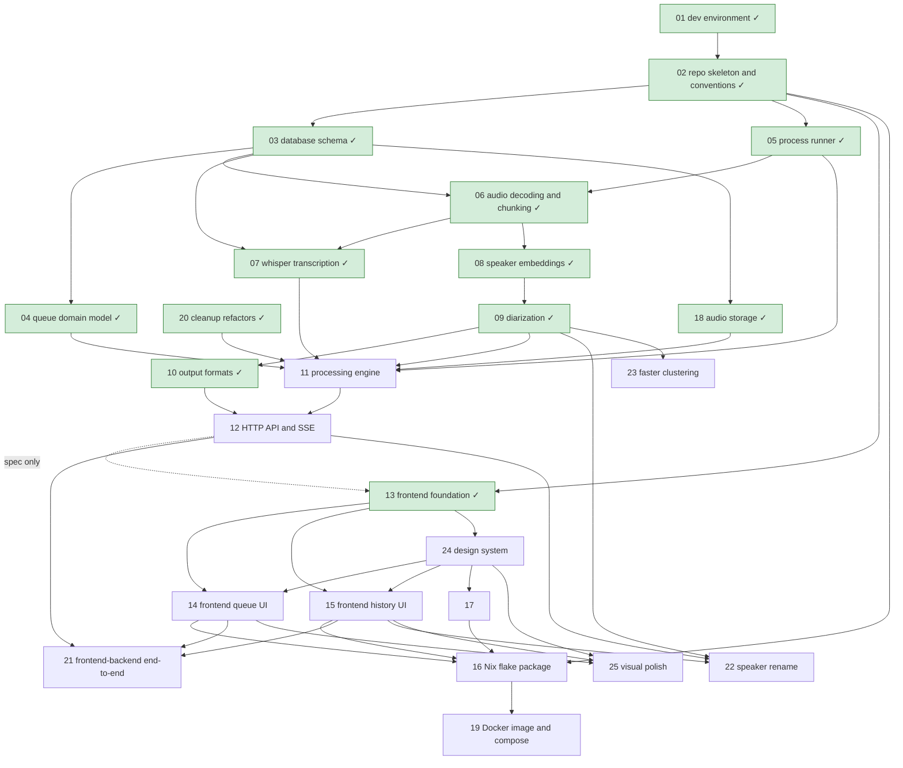

# Roadmap

Pending work, one file per item. Every item is specified, given a test list, and approved together with the user before any code is written (see [AGENTS.md § Workflow](../AGENTS.md#workflow)). Done items leave this folder: their spec and final test list move to `docs/specs/<area>.md`.

## Status legend

`draft` → `spec-approved` → `in-progress` → `in-review` → `done`

- `draft`: proposal written, not yet discussed with the user.
- `spec-approved`: proposal, open questions, and test list approved by the user (dated line in the item's Approval log).
- `in-progress`: being implemented in `workspaces/<NN-slug>` on branch `roadmap/<NN-slug>` (status set in the worktree's copy).
- `in-review`: full diff presented to the user.
- `done`: merged into `main`; file removed from `roadmap/`, its row links to the spec in `docs/specs/`.

## Dependency graph

## Items

| Item | Status | Depends on |
| ---- | ------ | ---------- |
| [01 — Dev environment](../docs/specs/dev-environment.md) | done | — |
| [02 — Repo skeleton and conventions](../docs/specs/repo-skeleton-and-conventions.md) | done | 01 |
| [03 — Database schema](../docs/specs/database-schema.md) | done | 02 |
| [04 — Queue domain model](../docs/specs/queue-domain-model.md) | done | 03 |
| [05 — Process runner](../docs/specs/process-runner.md) | done | 02 |
| [06 — Audio decoding and chunking](../docs/specs/audio-decoding-and-chunking.md) | done | 03, 05 |
| [07 — Whisper transcription](../docs/specs/whisper-transcription.md) | done | 03, 06 |
| [08 — Speaker embeddings](../docs/specs/speaker-embeddings.md) | done | 06 |
| [09 — Diarization](../docs/specs/diarization.md) | done | 08 |
| [10 — Output formats](../docs/specs/output-formats.md) | done | 09 |
| [11 — Processing engine](11-processing-engine.md) | spec-approved | 04, 05, 07, 09, 18, 20 |
| [12 — HTTP API and SSE](12-http-api-and-sse.md) | spec-approved | 10, 11 |
| [13 — Frontend foundation](../docs/specs/frontend-foundation.md) | done | 02, 12 (spec-approved only) |
| [14 — Frontend queue UI](14-frontend-queue-ui.md) | spec-approved | 13, 24 |
| [15 — Frontend history UI](15-frontend-history-ui.md) | spec-approved | 13, 24 |
| [16 — Nix flake package](16-nix-flake-package.md) | draft | 02, 14, 15, 17 |
| [17 — Branding: stenographer typing animation](17-branding-stenographer-animation.md) | spec-approved | 13, 24 |
| [18 — Audio storage: originals in the work directory, chunks as FLAC](../docs/specs/audio-storage.md) | done | 03 |
| [19 — Docker image and docker-compose setup](19-docker-image-and-compose.md) | draft | 16 |
| [20 — Cleanup refactors](../docs/specs/cleanup-refactors.md) | done | — |
| [21 — Frontend–backend end-to-end check](21-frontend-backend-end-to-end.md) | draft | 12, 13, 14, 15 |
| [22 — Rename and merge a task's speakers](22-speaker-rename.md) | draft | 09, 10, 12, 15 |
| [23 — Faster speaker clustering](23-faster-clustering.md) | spec-approved | 09 |
| [24 — Design system: tokens and primitives](24-visual-design.md) | spec-approved | 13 |
| [25 — Visual polish pass](25-visual-polish.md) | spec-approved | 24, 14, 15 |
