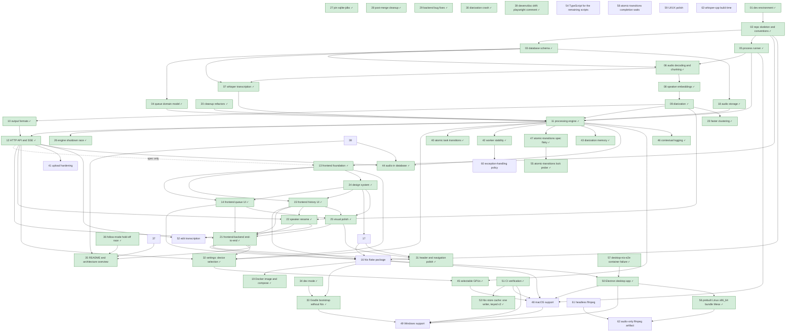

# Roadmap

Pending work, one file per item. Every item is specified, given a test list, and approved together with the user before any code is written (see [AGENTS.md § Workflow](../AGENTS.md#workflow)). Done items leave this folder: their spec and final test list move to `docs/specs/<area>.md`.

## Status legend

`draft` → `spec-approved` → `in-progress` → `in-review` → `done`

- `draft`: proposal written, not yet discussed with the user.
- `spec-approved`: proposal, open questions, and test list approved by the user (dated line in the item's Approval log).
- `in-progress`: being implemented in `workspaces/<NN-slug>` on branch `roadmap/<NN-slug>` (status set in the worktree's copy).
- `in-review`: full diff presented to the user.
- `done`: the item was approved; its squashed PR branch already carries the finished state — the spec and final test list in `docs/specs/<area>.md`, this file's row pointing there, and the roadmap file deleted — so `main` holds no roadmap copy from the merge on.

## Dependency graph

## Items

| Item | Status | Depends on |
| ---- | ------ | ---------- |
| [01 — Dev environment](../docs/specs/dev-environment.md) | done | — |
| [02 — Repo skeleton and conventions](../docs/specs/repo-skeleton-and-conventions.md) | done | 01 |
| [03 — Database schema](../docs/specs/database-schema.md) | done | 02 |
| [04 — Queue domain model](../docs/specs/queue-domain-model.md) | done | 03 |
| [05 — Process runner](../docs/specs/process-runner.md) | done | 02 |
| [06 — Audio decoding and chunking](../docs/specs/audio-decoding-and-chunking.md) | done | 03, 05 |
| [07 — Whisper transcription](../docs/specs/whisper-transcription.md) | done | 03, 06 |
| [08 — Speaker embeddings](../docs/specs/speaker-embeddings.md) | done | 06 |
| [09 — Diarization](../docs/specs/diarization.md) | done | 08 |
| [10 — Output formats](../docs/specs/output-formats.md) | done | 09 |
| [11 — Processing engine](../docs/specs/processing-engine.md) | done | 04, 05, 07, 09, 18, 20 |
| [12 — HTTP API and SSE](../docs/specs/http-api-and-sse.md) | done | 10, 11 |
| [13 — Frontend foundation](../docs/specs/frontend-foundation.md) | done | 02, 12 (spec-approved only) |
| [14 — Frontend queue UI](../docs/specs/frontend-queue-ui.md) | done | 13, 24 |
| [15 — Frontend history UI](../docs/specs/frontend-history-ui.md) | done | 13, 24 |
| [16 — Nix flake package](../docs/specs/nix-flake-package.md) | done | 02, 14, 15, 17, 21 |
| [17 — Branding: stenographer typing animation](../docs/specs/branding-stenographer-animation.md) | done | 13, 24 |
| [18 — Audio storage: originals in the work directory, chunks as FLAC](../docs/specs/audio-storage.md) | done | 03 |
| [19 — Docker image and docker-compose setup](../docs/specs/docker-image-and-compose.md) | done | 16 |
| [20 — Cleanup refactors](../docs/specs/cleanup-refactors.md) | done | — |
| [21 — Frontend–backend end-to-end check](../docs/specs/frontend-backend-end-to-end.md) | done | 12, 13, 14, 15, 22, 25 |
| [22 — Rename and merge a task's speakers](../docs/specs/speaker-rename.md) | done | 09, 10, 12, 15 |
| [23 — Faster speaker clustering](../docs/specs/faster-clustering.md) | done | 09 |
| [24 — Design system: tokens and primitives](../docs/specs/design-system.md) | done | 13 |
| [25 — Visual polish pass](../docs/specs/visual-polish.md) | done | 24, 14, 15 |
| [26 — Engine start/stop race (flaky DatabaseDependencySpec)](../docs/specs/engine-shutdown-race.md) | done | 11 |
| [27 — Pin the sqlite-jdbc version](../docs/specs/sqlite-jdbc-pin.md) | done | — |
| [28 — Post-merge cleanup refactors](../docs/specs/cleanup-refactors.md) | done | — |
| [29 — Post-merge bug fixes: engine wake, seek bar, audio join, SSE disconnect](../docs/specs/post-merge-bug-fixes.md) | done | — |
| [30 — Diarization crash on the user's machine (ONNX Runtime recursion)](../docs/specs/onnxruntime-pin.md) | done | — |
| [31 — Header and navigation polish](../docs/specs/header-and-navigation-polish.md) | done | 17, 25, 21 |
| [32 — Settings page: device, threads and upload defaults](../docs/specs/settings-page.md) | done | 11, 12, 13, 21 |
| [33 — Gradle bootstrap for developers without Nix](../docs/specs/gradle-bootstrap.md) | done | 16, 34 |
| [34 — Dev mode: frontend and backend with one command](../docs/specs/dev-mode.md) | done | — |
| [35 — README and architecture overview](../docs/specs/readme-and-architecture.md) | done | 21 |
| [36 — Follow mode stops by itself (hold-off race)](../docs/specs/follow-mode-hold-off-race.md) | done | 15, 21 |
| [37 — Audio request 500: the joiner shares the engine's single-flight runner](../docs/specs/audio-join-isolation.md) | done | 15 |
| [38 — Joined playback stalls at ~90 s of a long clip](../docs/specs/joined-playback-stalls.md) | done | 15 |
| [39 — devenv/doc drift: the playwright version comment](../docs/specs/playwright-version-sync.md) | done | 16 |
| [40 — Task transitions are not atomic (pause/resume race a finishing task)](../docs/specs/atomic-task-transitions.md) | done | 11 |
| [41 — Upload hardening: duplicate race, size limit, spool cleanup](41-upload-hardening.md) | draft | 12 |
| [42 — Worker stability: no per-task exception may leave the task stuck or kill the queue, and no command may race a task's start](../docs/specs/worker-stability.md) | done | 11 |
| [43 — Diarization memory: stream speaker windows from the stored clip](../docs/specs/diarization-memory.md) | done | 11 |
| [44 — Store the full audio in the database; drop the file cache](../docs/specs/audio-in-database.md) | done | 11, 12, 38 |
| [45 — Make both GPUs selectable: enumerate physical Vulkan devices](../docs/specs/device-selection.md) | done | 11, 32 |
| [46 — Contextual logging: the task's id in every log line (MDC) and named coroutines](../docs/specs/contextual-logging.md) | done | 11 |
| [47 — ProcessingEngineAtomicTransitionsSpec is schedule-dependent (flaky)](../docs/specs/atomic-transitions-spec-flaky.md) | done | 11 |
| [48 — macOS support](48-macos-support.md) | spec-approved | 05, 16, 45, 50, 51 |
| [49 — Windows support](49-windows-support.md) | spec-approved | 33, 48, 50, 51 |
| [50 — Electron desktop app](../docs/specs/electron-desktop-app.md) | done | 16 |
| [51 — CI verification: first GitHub Actions workflow](../docs/specs/ci-verification.md) | done | — |
| [52 — Edit the transcription: correct a segment's text, with isolated segment playback](52-edit-transcription.md) | spec-approved | 12, 22 |
| [53 — The Nix store cache: one writer per key, versioned past the stale entry](../docs/specs/nix-store-cache.md) | done | 51 |
| [54 — TypeScript for the remaining hand-written JavaScript](54-typescript-for-the-remaining-scripts.md) | draft | — |
| [55 — The atomic-transitions pin's writer-lock probe is still schedule-dependent](../docs/specs/atomic-transitions-lock-probe.md) | done | — |
| [56 — Prebuild the desktop bundle's Vulkan-only Mesa for Linux x86_64](../docs/specs/desktop-bundle-mesa-artifact.md) | done | 50 |
| [57 — Diagnose and fix the desktop-nix-e2e container exit 6](../docs/specs/desktop-nix-e2e-container-failure.md) | done | — |
| [58 — The atomic-transitions spec's completion waits still have real-time windows](58-atomic-transitions-spec-completion-window.md) | spec-approved | — |
| [59 — UI/UX polish: compact header, view hierarchy, task-row progress, history affordances](59-ui-ux-polish.md) | spec-approved | — |
| [60 — Exception-handling policy: no catch-all swallows a throwable silently](60-exception-handling-policy.md) | spec-approved | 42 |
| [61 — Ship nixpkgs' cached headless ffmpeg](61-headless-ffmpeg.md) | spec-approved | — |
| [62 — An audio-only ffmpeg, shipped as a pinned prebuilt artifact](62-audio-only-ffmpeg-artifact.md) | draft | 56, 61 |
| [63 — Stop compiling whisper-cpp on every uncached machine](63-whisper-cpp-build-time.md) | draft | — |
