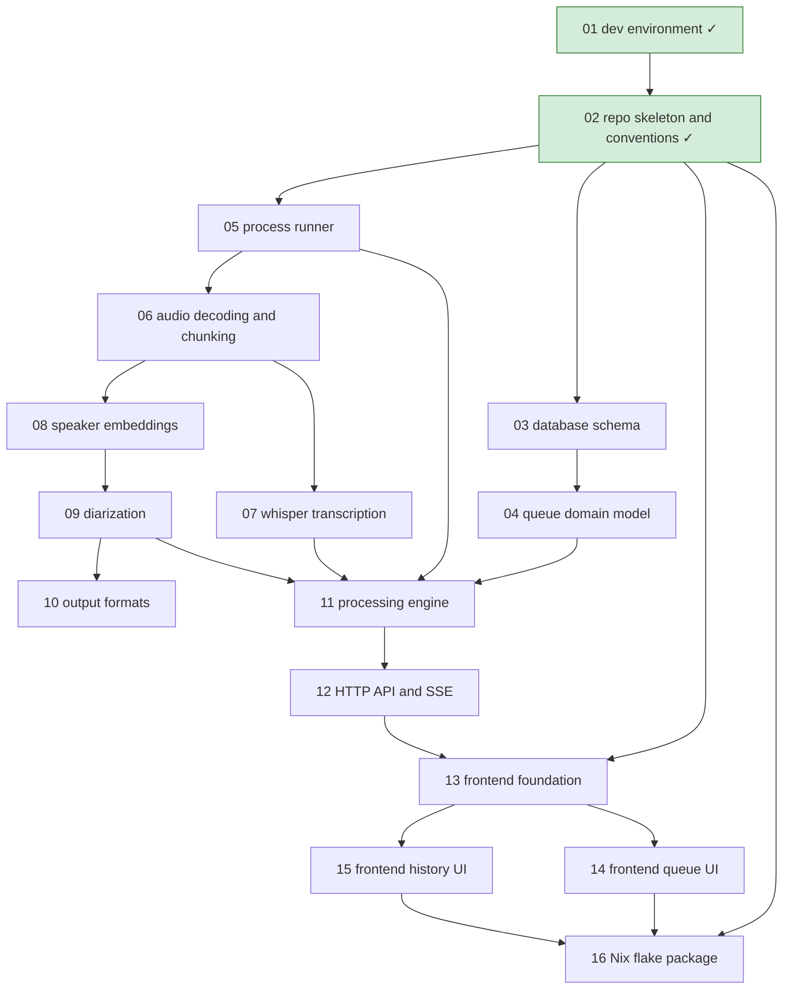

# Roadmap

Pending work, one file per item. Every item is specified, given a test list, and approved together with the user before any code is written (see [AGENTS.md § Workflow](../AGENTS.md#workflow)). Done items leave this folder: their spec and final test list move to `docs/specs/<area>.md`.

## Status legend

`draft` → `spec-approved` → `in-progress` → `in-review` → `done`

- `draft`: proposal written, not yet discussed with the user.
- `spec-approved`: proposal, open questions, and test list approved by the user (dated line in the item's Approval log).
- `in-progress`: being implemented in `workspaces/<NN-slug>` on branch `roadmap/<NN-slug>` (status set in the worktree's copy).
- `in-review`: full diff presented to the user.
- `done`: merged into `main`; file removed from `roadmap/`, its row links to the spec in `docs/specs/`.

## Dependency graph

## Items

| Item | Status | Depends on |
| ---- | ------ | ---------- |
| [01 — Dev environment](../docs/specs/dev-environment.md) | done | — |
| [02 — Repo skeleton and conventions](../docs/specs/repo-skeleton-and-conventions.md) | done | 01 |
| [03 — Database schema](03-database-schema.md) | draft | 02 |
| [04 — Queue domain model](04-queue-domain-model.md) | draft | 03 |
| [05 — Process runner](05-process-runner.md) | draft | 02 |
| [06 — Audio decoding and chunking](06-audio-decoding-and-chunking.md) | draft | 05 |
| [07 — Whisper transcription](07-whisper-transcription.md) | draft | 06 |
| [08 — Speaker embeddings](08-speaker-embeddings.md) | draft | 06 |
| [09 — Diarization](09-diarization.md) | draft | 08 |
| [10 — Output formats](10-output-formats.md) | draft | 09 |
| [11 — Processing engine](11-processing-engine.md) | draft | 04, 05, 07, 09 |
| [12 — HTTP API and SSE](12-http-api-and-sse.md) | draft | 11 |
| [13 — Frontend foundation](13-frontend-foundation.md) | draft | 02, 12 |
| [14 — Frontend queue UI](14-frontend-queue-ui.md) | draft | 13 |
| [15 — Frontend history UI](15-frontend-history-ui.md) | draft | 13 |
| [16 — Nix flake package](16-nix-flake-package.md) | draft | 02, 14, 15 |
