# Roadmap

Pending work, one file per item. Every item is specified, given a test list, and approved together with the user before any code is written (see [AGENTS.md § Workflow](../AGENTS.md#workflow)). Done items leave this folder: their spec and final test list move to `docs/specs/<area>.md`.

## Status legend

`draft` → `spec-approved` → `in-progress` → `in-review` → `done`

- `draft`: proposal written, not yet discussed with the user.
- `spec-approved`: proposal, open questions, and test list approved by the user (dated line in the item's Approval log).
- `in-progress`: being implemented in `workspaces/<NN-slug>` on branch `roadmap/<NN-slug>` (status set in the worktree's copy).
- `in-review`: full diff presented to the user.
- `done`: the item was approved; its squashed PR branch already carries the finished state — the spec and final test list in `docs/specs/<area>.md`, this file's row pointing there, and the roadmap file deleted — so `main` holds no roadmap copy from the merge on.

## Dependency graph

```mermaid
graph TD
  01[01 dev environment ✓]:::done --> 02[02 repo skeleton and conventions ✓]:::done
  02 --> 03[03 database schema ✓]:::done
  03 --> 04[04 queue domain model ✓]:::done
  02 --> 05[05 process runner ✓]:::done
  05 --> 06[06 audio decoding and chunking ✓]:::done
  03 --> 06
  06 --> 07[07 whisper transcription ✓]:::done
  03 --> 07
  06 --> 08[08 speaker embeddings ✓]:::done
  08 --> 09[09 diarization ✓]:::done
  09 --> 10[10 output formats ✓]:::done
  04 --> 11[11 processing engine ✓]:::done
  05 --> 11
  07 --> 11
  09 --> 11
  03 --> 18[18 audio storage ✓]:::done
  18 --> 11
  20 --> 11
  11 --> 12[12 HTTP API and SSE ✓]:::done
  10 --> 12
  02 --> 13[13 frontend foundation ✓]:::done
  12 -. spec only .-> 13
  13 --> 14[14 frontend queue UI ✓]:::done
  13 --> 15[15 frontend history UI ✓]:::done
  02 --> 16[16 Nix flake package ✓]:::done
  14 --> 16
  15 --> 16
  17[17 Branding: stenographer typing animation ✓]:::done --> 16
  20[20 cleanup refactors ✓]:::done
  12 --> 21[21 frontend-backend end-to-end ✓]:::done
  14 --> 21
  15 --> 21
  22 --> 21
  25 --> 21
  16 --> 19[19 Docker image and compose ✓]:::done
  21 --> 16
  09 --> 22[22 speaker rename ✓]:::done
  12 --> 22
  15 --> 22
  09 --> 23[23 faster clustering ✓]:::done
  13 --> 24[24 design system ✓]:::done
  24 --> 14
  24 --> 15
  24 --> 17
  24 --> 25[25 visual polish ✓]:::done
  14 --> 25
  15 --> 25
  11 --> 26[26 engine shutdown race ✓]:::done
  27[27 pin sqlite-jdbc ✓]:::done
  28[28 post-merge cleanup ✓]:::done
  29[29 backend bug fixes ✓]:::done
  30[30 diarization crash ✓]:::done
  17 --> 31[31 header and navigation polish ✓]:::done
  25 --> 31
  21 --> 31
  11 --> 32[32 settings: device selection ✓]:::done
  12 --> 32
  13 --> 32
  21 --> 32
  16 --> 33[33 Gradle bootstrap without Nix ✓]:::done
  34 --> 33
  34[34 dev mode ✓]:::done
  21 --> 35[35 README and architecture overview ✓]:::done
  36[36 follow-mode hold-off race ✓]:::done --> 35[35 README and architecture overview ✓]:::done
  37[37 Audio request 500: the joiner shares the engine's single-flight runner ✓]:::done --> 35[35 README and architecture overview ✓]:::done
  38[38 Joined playback stalls at ~90 s of a long clip ✓]:::done --> 35[35 README and architecture overview ✓]:::done
  39[39 devenv/doc drift: playwright comment ✓]:::done
  11 --> 40[40 atomic task transitions ✓]:::done
  12 --> 41[41 upload hardening ✓]:::done
  11 --> 42[42 worker stability ✓]:::done
  11 --> 47[47 atomic-transitions spec flaky ✓]:::done
  51[51 CI verification ✓]:::done
  51 --> 53[53 Nix store cache: one writer, keyed v2 ✓]:::done
  51 --> 48[48 macOS support ✓]:::done
  05 --> 48
  16 --> 48
  45 --> 48
  33 --> 49[49 Windows support ✓]:::done
  48 --> 49
  51 --> 49
  16 --> 50[50 Electron desktop app ✓]:::done
  50 --> 48
  50 --> 49
  22 --> 52[52 edit transcription ✓]:::done
  12 --> 52
  49 --> 54[54 TypeScript for the remaining scripts ✓]:::done
  11 --> 43[43 diarization memory ✓]:::done
  38 --> 44[44 audio in database ✓]:::done
  11 --> 44
  11 --> 45[45 selectable GPUs ✓]:::done
  32 --> 45
  12 --> 44
  11 --> 46[46 contextual logging ✓]:::done
  47 --> 55[55 atomic-transitions lock probe ✓]:::done
  50 --> 56[56 prebuilt Linux x86_64 bundle Mesa ✓]:::done
  57[57 desktop-nix-e2e container failure ✓]:::done --> 50
  58[58 atomic-transitions completion waits ✓]:::done
  59[59 UI/UX polish ✓]:::done
  42 --> 60[60 exception-handling policy ✓]:::done
  61[61 headless ffmpeg ✓]:::done --> 62[62 audio-only ffmpeg ✓]:::done
  56 --> 62
  63[63 whisper-cpp build time ✓]:::done
  50 --> 64[64 evaluate Tauri ✓]:::done
  65[65 fix the row-color phase observation ✓]:::done
  64 --> 66[66 local service and frontend flavors]
  48 --> 66
  49 --> 66
  66 --> 67[67 TUI frontend]
  66 --> 70[70 Rust GUI window]
  67 --> 70
  49 --> 70
  70 --> 76
  62 --> 68[68 Windows audio-only ffmpeg ✓]:::done
  49 --> 68
  62 --> 69[69 macOS audio-only ffmpeg ✓]:::done
  48 --> 69
  70[70 Rust GUI window]
  71[71 repository and chunking performance ✓]:::done
  72[72 frontend state and errors ✓]:::done
  73[73 split a speaker]
  74[74 desktop presentation]
  75[75 retire the Python oracle ✓]:::done
  76[76 RTL transcription]
  77[77 private test temp dirs ✓]:::done
  83[83 diarization accuracy]
  84[84 e2e reliability]
  73 --> 83
  81[81 dropped row command ✓]:::done
  78[78 stable release]
  49 --> 78
  52 --> 78
  65 --> 78
  68 --> 78
  69 --> 78
  72 --> 78
  74 --> 78
  76 --> 78
  77 --> 78
  79[79 full e2e journey on Windows ✓]:::done
  21 --> 79
  49 --> 79
  51 --> 79
  79 --> 78
  84 --> 78
  80[80 docs-only CI ✓]:::done
  49 --> 80
  51 --> 80
  82[82 CI diagnosability ✓]:::done
  classDef done fill:#d4edda,stroke:#2e7d32
```

## Items

| Item                                                                                                                                                                 | Status        | Depends on                  |
| -------------------------------------------------------------------------------------------------------------------------------------------------------------------- | ------------- | --------------------------- |
| [01 — Dev environment](../docs/specs/dev-environment.md)                                                                                                             | done          | —                           |
| [02 — Repo skeleton and conventions](../docs/specs/repo-skeleton-and-conventions.md)                                                                                 | done          | 01                          |
| [03 — Database schema](../docs/specs/database-schema.md)                                                                                                             | done          | 02                          |
| [04 — Queue domain model](../docs/specs/queue-domain-model.md)                                                                                                       | done          | 03                          |
| [05 — Process runner](../docs/specs/process-runner.md)                                                                                                               | done          | 02                          |
| [06 — Audio decoding and chunking](../docs/specs/audio-decoding-and-chunking.md)                                                                                     | done          | 03, 05                      |
| [07 — Whisper transcription](../docs/specs/whisper-transcription.md)                                                                                                 | done          | 03, 06                      |
| [08 — Speaker embeddings](../docs/specs/speaker-embeddings.md)                                                                                                       | done          | 06                          |
| [09 — Diarization](../docs/specs/diarization.md)                                                                                                                     | done          | 08                          |
| [10 — Output formats](../docs/specs/output-formats.md)                                                                                                               | done          | 09                          |
| [11 — Processing engine](../docs/specs/processing-engine.md)                                                                                                         | done          | 04, 05, 07, 09, 18, 20      |
| [12 — HTTP API and SSE](../docs/specs/http-api-and-sse.md)                                                                                                           | done          | 10, 11                      |
| [13 — Frontend foundation](../docs/specs/frontend-foundation.md)                                                                                                     | done          | 02, 12 (spec-approved only) |
| [14 — Frontend queue UI](../docs/specs/frontend-queue-ui.md)                                                                                                         | done          | 13, 24                      |
| [15 — Frontend history UI](../docs/specs/frontend-history-ui.md)                                                                                                     | done          | 13, 24                      |
| [16 — Nix flake package](../docs/specs/nix-flake-package.md)                                                                                                         | done          | 02, 14, 15, 17, 21          |
| [17 — Branding: stenographer typing animation](../docs/specs/branding-stenographer-animation.md)                                                                     | done          | 13, 24                      |
| [18 — Audio storage: originals in the work directory, chunks as FLAC](../docs/specs/audio-storage.md)                                                                | done          | 03                          |
| [19 — Docker image and docker-compose setup](../docs/specs/docker-image-and-compose.md)                                                                              | done          | 16                          |
| [20 — Cleanup refactors](../docs/specs/cleanup-refactors.md)                                                                                                         | done          | —                           |
| [21 — Frontend–backend end-to-end check](../docs/specs/frontend-backend-end-to-end.md)                                                                               | done          | 12, 13, 14, 15, 22, 25      |
| [22 — Rename and merge a task's speakers](../docs/specs/speaker-rename.md)                                                                                           | done          | 09, 10, 12, 15              |
| [23 — Faster speaker clustering](../docs/specs/faster-clustering.md)                                                                                                 | done          | 09                          |
| [24 — Design system: tokens and primitives](../docs/specs/design-system.md)                                                                                          | done          | 13                          |
| [25 — Visual polish pass](../docs/specs/visual-polish.md)                                                                                                            | done          | 24, 14, 15                  |
| [26 — Engine start/stop race (flaky DatabaseDependencySpec)](../docs/specs/engine-shutdown-race.md)                                                                  | done          | 11                          |
| [27 — Pin the sqlite-jdbc version](../docs/specs/sqlite-jdbc-pin.md)                                                                                                 | done          | —                           |
| [28 — Post-merge cleanup refactors](../docs/specs/cleanup-refactors.md)                                                                                              | done          | —                           |
| [29 — Post-merge bug fixes: engine wake, seek bar, audio join, SSE disconnect](../docs/specs/post-merge-bug-fixes.md)                                                | done          | —                           |
| [30 — Diarization crash on the user's machine (ONNX Runtime recursion)](../docs/specs/onnxruntime-pin.md)                                                            | done          | —                           |
| [31 — Header and navigation polish](../docs/specs/header-and-navigation-polish.md)                                                                                   | done          | 17, 25, 21                  |
| [32 — Settings page: device, threads and upload defaults](../docs/specs/settings-page.md)                                                                            | done          | 11, 12, 13, 21              |
| [33 — Gradle bootstrap for developers without Nix](../docs/specs/gradle-bootstrap.md)                                                                                | done          | 16, 34                      |
| [34 — Dev mode: frontend and backend with one command](../docs/specs/dev-mode.md)                                                                                    | done          | —                           |
| [35 — README and architecture overview](../docs/specs/readme-and-architecture.md)                                                                                    | done          | 21                          |
| [36 — Follow mode stops by itself (hold-off race)](../docs/specs/follow-mode-hold-off-race.md)                                                                       | done          | 15, 21                      |
| [37 — Audio request 500: the joiner shares the engine's single-flight runner](../docs/specs/audio-join-isolation.md)                                                 | done          | 15                          |
| [38 — Joined playback stalls at ~90 s of a long clip](../docs/specs/joined-playback-stalls.md)                                                                       | done          | 15                          |
| [39 — devenv/doc drift: the playwright version comment](../docs/specs/playwright-version-sync.md)                                                                    | done          | 16                          |
| [40 — Task transitions are not atomic (pause/resume race a finishing task)](../docs/specs/atomic-task-transitions.md)                                                | done          | 11                          |
| [41 — Upload hardening: duplicate race, size limit, spool cleanup](../docs/specs/upload-hardening.md)                                                                | done          | 12                          |
| [42 — Worker stability: no per-task exception may leave the task stuck or kill the queue, and no command may race a task's start](../docs/specs/worker-stability.md) | done          | 11                          |
| [43 — Diarization memory: stream speaker windows from the stored clip](../docs/specs/diarization-memory.md)                                                          | done          | 11                          |
| [44 — Store the full audio in the database; drop the file cache](../docs/specs/audio-in-database.md)                                                                 | done          | 11, 12, 38                  |
| [45 — Make both GPUs selectable: enumerate physical Vulkan devices](../docs/specs/device-selection.md)                                                               | done          | 11, 32                      |
| [46 — Contextual logging: the task's id in every log line (MDC) and named coroutines](../docs/specs/contextual-logging.md)                                           | done          | 11                          |
| [47 — ProcessingEngineAtomicTransitionsSpec is schedule-dependent (flaky)](../docs/specs/atomic-transitions-spec-flaky.md)                                           | done          | 11                          |
| [48 — macOS support](../docs/specs/macos-support.md) | done | 05, 16, 45, 50, 51 |
| [49 — Windows support](../docs/specs/windows-support.md)                                                                                                                        | done          | 33, 48, 50, 51              |
| [50 — Electron desktop app](../docs/specs/electron-desktop-app.md)                                                                                                   | done          | 16                          |
| [51 — CI verification: first GitHub Actions workflow](../docs/specs/ci-verification.md)                                                                              | done          | —                           |
| [52 — Edit the transcription: correct a segment's text, with isolated segment playback](../docs/specs/edit-transcription.md)                                                    | done          | 12, 22                      |
| [53 — The Nix store cache: one writer per key, versioned past the stale entry](../docs/specs/nix-store-cache.md)                                                     | done          | 51                          |
| [54 — TypeScript for the remaining hand-written JavaScript](../docs/specs/typescript-for-the-remaining-scripts.md)                                                              | done          | 49                          |
| [55 — The atomic-transitions pin's writer-lock probe is still schedule-dependent](../docs/specs/atomic-transitions-lock-probe.md)                                    | done          | —                           |
| [56 — Prebuild the desktop bundle's Vulkan-only Mesa for Linux x86_64](../docs/specs/desktop-bundle-mesa-artifact.md)                                                | done          | 50                          |
| [57 — Diagnose and fix the desktop-nix-e2e container exit 6](../docs/specs/desktop-nix-e2e-container-failure.md)                                                     | done          | —                           |
| [58 — The atomic-transitions spec's completion waits still have real-time windows](../docs/specs/atomic-transitions-completion-waits.md)                             | done          | —                           |
| [59 — UI/UX polish: compact header, view hierarchy, task-row progress, history affordances](../docs/specs/ui-ux-polish.md)                                           | done          | —                           |
| [60 — Exception-handling policy: no catch-all swallows a throwable silently](../docs/specs/exception-handling-policy.md)                                             | done          | 42                          |
| [61 — Ship nixpkgs' cached headless ffmpeg](../docs/specs/headless-ffmpeg.md)                                                                                        | done          | —                           |
| [62 — An audio-only ffmpeg, shipped as a pinned prebuilt artifact](../docs/specs/audio-only-ffmpeg.md)                                                               | done          | 56, 61                      |
| [63 — Stop compiling whisper-cpp on every uncached machine](../docs/specs/whisper-cpp-artifact.md)                                                                   | done          | —                           |
| [64 — Evaluate Tauri as the desktop shell](../docs/specs/tauri-evaluation.md) | done | 50 |
| [65 — `59-row-color`'s chunking-phase observation is flaky](../docs/specs/row-color-phase-observation.md)                                                                    | done          | —                           |
| [66 — A per-user local service with selectable frontends (browser, window, TUI; tray optional)](66-local-service-and-frontends.md)                                   | spec-approved | 48, 49, 64                  |
| [67 — A terminal UI frontend](67-tui-frontend.md)                                                                                                                  | spec-approved | 66                          |
| [68 — An audio-only ffmpeg for Windows, shipped as a pinned prebuilt artifact](../docs/specs/windows-audio-only-ffmpeg.md)                                                    | done          | 62, 49                      |
| [69 — An audio-only ffmpeg for macOS aarch64-darwin, shipped as a pinned prebuilt artifact](../docs/specs/macos-audio-only-ffmpeg.md) | done | 62, 48 |
| [70 — Replace Electron with a Rust GUI for the window flavor](70-rust-gui-window.md)                                                                               | spec-approved | 49, 66, 67                  |
| [71 — Repository and chunking performance: indexed queue queries, one list query, bounded chunking memory](../docs/specs/repository-and-chunking-performance.md)    | done          | —                           |
| [72 — Frontend state and error handling: visible errors, one settings owner, auto-save with a restore-defaults reset](../docs/specs/frontend-state-and-errors.md)                       | done          | —                           |
| [73 — Split a speaker: move selected turns to a new speaker](73-diarization-speaker-separation.md)                                                                 | spec-approved | —                           |
| [74 — Desktop presentation: font coverage, Japanese glyphs, app icon and desktop entry](74-desktop-presentation.md)                                                 | spec-approved | —                           |
| [75 — Retire the Python oracle: the app is the behavioral reference](../docs/specs/oracle-retirement.md)                                                               | done          | —                           |
| [76 — Right-to-left transcription: direction-aware transcripts and layout](76-right-to-left-transcription.md)                                                      | spec-approved | 70                           |
| [77 — Private test temp dirs for the backend suite, and a named leak in the upload spec](../docs/specs/test-harness-temp-dirs.md)                                            | done          | —                           |
| [78 — The first stable release: release gates, one version everywhere, and the release process](78-stable-release.md)                                         | spec-approved | 49, 52, 65, 68, 69, 72, 74, 76, 77, 79 |
| [79 — The full e2e journey on Windows](../docs/specs/windows-e2e-journey.md)                                                                                 | done          | 21, 49, 51                  |
| [80 — Documentation-only pull requests skip the heavy CI jobs](../docs/specs/docs-only-ci.md)                                                                                | done          | 49, 51                      |
| [82 — A red CI job is diagnosable from CI alone, and a check job does not fail for the network](../docs/specs/ci-diagnosability.md)                                | done          | —                           |
| [81 — A row command clicked while another one is in flight is dropped](../docs/specs/dropped-row-command.md)                                                                  | done          | —                           |
| [83 — Diarization accuracy: fewer wrongly merged and wrongly split speakers in automatic detection](83-diarization-accuracy.md)                                    | spec-approved | 73                          |
| [84 — e2e reliability: a Windows journey that can gate again, no wall-clock or sleep-based assertions, and a journey that tests the current UI](84-e2e-reliability.md) | spec-approved | —                           |
